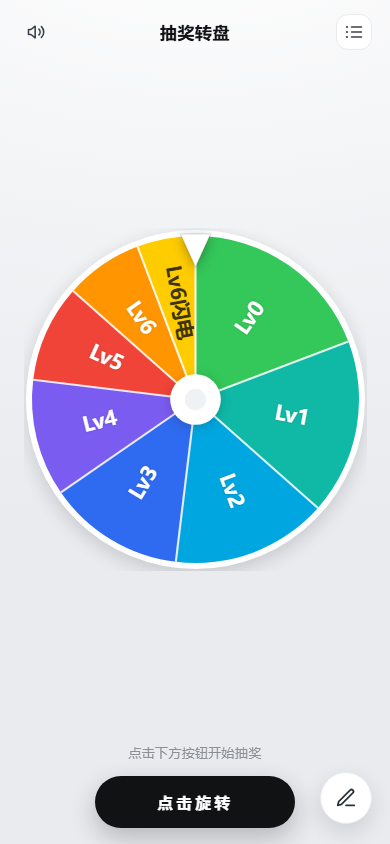
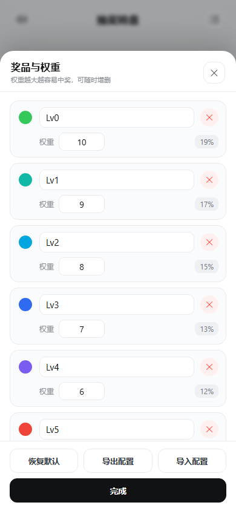
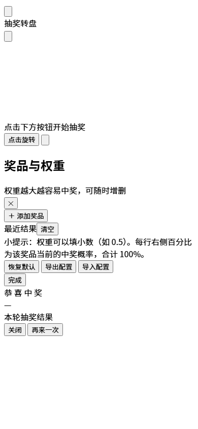

# 抽奖转盘 · DaFeiYu Wheel

> 带权重的抽奖转盘 —— 可以做桌面软件（Electron，双击即用），也可以直接当网页用。
> 零第三方依赖、完全离线、配置自动保存。

<p>
  
  
  
  
</p>

转盘会先快后慢地转 5~7 圈，停住后指针指着谁就中谁，再弹出中奖信息（含彩带与音效）。
奖品和权重随时可改，右侧自动算出每个奖品的中奖概率。

| 主界面 | 奖品与权重 | 中奖弹窗 |
| :---: | :---: | :---: |
|  |  |  |

---

## ✨ 功能

- **加权抽奖**：每个奖品可设权重，权重越大越容易中；界面实时显示概率百分比（合计 100%）
- **真实转动动画**：先快后慢转 5~7 圈，约 4.6~5.6 秒，经过扇区有「哒哒」声，停稳后才公布结果
- **指针即结果**：中奖结果按「指针实际停住的扇区」判定，和画面所见完全一致
- **自由编辑**：增删奖品、改名字、改颜色、改权重；支持小数权重
- **自动保存**：奖品、权重、颜色、音效开关、最近记录都存在本地，下次打开原样恢复
- **导入 / 导出**：配置可存成 JSON，换电脑、换浏览器都能带走
- **音效开关**、**最近结果**、**恢复默认**、Esc / 空格快捷键
- **自适应**：桌面窗口和手机浏览器都能用
- **零依赖**：前端只用原生 HTML/CSS/JS + Canvas，没有框架、没有 CDN、断网可用

## 🚀 三种用法

### 1. 桌面版（推荐，无需安装）

到 [Releases](../../releases) 下载 **`DaFeiYuWheel-x.y.z-win-x64.zip`**，解压后双击 `DaFeiYuWheel.exe` 即可。
绿色免安装，不写注册表、不需管理权限；窗口大小和位置会被记住。

> 也提供单文件版 `DaFeiYuWheel-x.y.z-portable.exe`（方便转发），但它每次启动都要自解压，比 zip 慢一些。
>
> **⚠️ 首次启动请耐心等 10~40 秒**：未签名的 Electron 程序会被 Windows Defender / 360 等完整扫描（约 240 MB），
> 这段时间**屏幕上不会出现任何界面**，不是打不开。第二次起只需 2~3 秒。
> 请**不要重复双击**（会开出多个窗口），也**不要**用「以管理员身份运行」打开。

### 2. 网页版（也可以放到手机上）

直接双击 `src/index.html` 用浏览器打开；或用任意静态服务器托管 `src/` 目录：

```bash
npx serve src        # 或者 python -m http.server -d src 8000
```

### 3. 从源码运行桌面版

```bash
npm install          # 或 pnpm install
npm start            # 开发模式运行
npm run dist         # 打包 Windows 免安装 exe → dist/
```

> 用 pnpm 的同学：如果看到 `Ignored build scripts: electron`，执行一次 `pnpm approve-builds`
> 允许 Electron 下载运行时即可（仓库里的 `pnpm-workspace.yaml` 已经预先放行）。npm 不受影响。

> 第一次 `npm run dist` 会联网下载 Electron 运行时与打包工具，请留出几分钟。

## 📤 发布到 GitHub

首次推送到 GitHub、打 tag 自动构建、发 Release 让下载 exe 的完整步骤见
**[docs/PUBLISH.md](docs/PUBLISH.md)**。

> Windows / macOS / Linux 的自动构建见 [.github/workflows/build.yml](.github/workflows/build.yml)，
> 推到 GitHub 后每次打 tag 会自动产出安装包。

## 📖 使用说明

详细图文说明见 [docs/USAGE.md](docs/USAGE.md)，这里是最短上手路径：

1. 点中间黑色 **「点击旋转」** 开始抽奖（也可以按空格 / 回车）。
2. 点右下角 **笔形按钮**（或右上角列表按钮）打开「奖品与权重」面板。
3. 每一行：彩色圆点改颜色、名称框改名、权重框填数字、红色 **✕** 删除；右侧是自动算好的中奖概率。
4. 点「完成」关闭面板，改动立即生效。

**权重怎么理解**：只看比例，不看数值大小。`A=10、B=5` 就是 A 的概率是 B 的 2 倍（66.7% : 33.3%）；
全部填 1 就是等概率；想让某个奖必中，把它权重调大、其他调小即可。

### 如果双击后没有窗口

Chromium 在**以管理员身份运行**时，部分系统上沙箱会初始化失败、程序直接静默退出。
这时用发布包里的 `兼容模式启动.bat`（等价于加 `--no-sandbox` 参数启动）即可；
正常双击（非管理员）不需要这么做。

## 🧠 实现要点

想改代码的话，这几个地方值得一看（都在 `src/app.js`）：

| 位置 | 说明 |
| --- | --- |
| `spanInfo()` | 把权重换算成每个扇区的起止角度 |
| `draw()` | Canvas 画扇区、沿半径排字、自动缩小字号避免细扇区文字重叠 |
| `pickIndex()` | 加权随机抽取（累积权重法） |
| `spin()` | 先按权重抽一个奖品，再反解出让该扇区正对指针所需的总旋转角度；rAF + 四次方缓出做动画，跨扇区触发音效；最后**按指针实际位置**再确认一次结果 |
| `settle()` | 兜底结算：切到后台标签页时 rAF 会暂停，用定时器保证一定能出结果，并阻止残留动画帧继续转动 |
| `finish()` | 记录结果 → 等转盘停稳 0.34s → 弹窗 + 彩带 + 音效 |

## 📁 项目结构

```
dafiyu-wheel/
├─ src/                     ← 前端（网页版就是这个目录，可直接托管）
│  ├─ index.html
│  ├─ styles.css
│  └─ app.js
├─ electron/
│  └─ main.js               ← 桌面壳：窗口、图标、全屏快捷键、窗口尺寸记忆
├─ build/                   ← 打包资源（应用图标 ico/png）
├─ docs/
│  ├─ USAGE.md              ← 详细使用说明
│  └─ screenshots/
├─ .github/workflows/       ← 多平台自动构建
├─ package.json
├─ LICENSE
└─ README.md
```

## 🎨 想改成自己的

- **默认奖品**：`src/app.js` 里的 `DEFAULT_NAMES`（名称 + 权重）
- **扇区配色**：`src/app.js` 里的 `PALETTE`
- **转盘圈数 / 时长**：`spin()` 里的 `turns` 和 `dur`
- **窗口默认尺寸**：`electron/main.js` 里的 `DEFAULT_SIZE`
- **应用名 / 图标**：`package.json` 的 `productName`、`build/icon.ico|png`

## 🗺 Roadmap

- [ ] 多套方案管理（一个文件存多个转盘，下拉切换）
- [ ] 抽中后自动移除该奖品（抽奖不重复模式）
- [ ] 全屏展示模式（投到大屏、隐藏界面元素）
- [ ] 中奖记录导出 CSV
- [ ] 深色主题

## 🤝 贡献

欢迎 Issue / PR。提交前请确保：

```bash
# 网页版能直接打开 src/index.html，且无控制台报错
npm start          # 桌面版能正常启动
```

## 📄 License

[MIT](LICENSE) © 2026 Macklin78

---

<details>
<summary><b>English</b></summary>

**DaFeiYu Wheel** — a weighted lucky-wheel / raffle spinner with zero runtime dependencies.

- Spin animation with weighted probability, stops on the pointer, then reveals the winner.
- Edit prizes, weights and colors in-app; probabilities are computed live.
- Everything is stored locally (localStorage); config can be exported/imported as JSON.
- Runs as a portable Electron desktop app **or** as a plain web page (`src/index.html`).

```bash
npm install && npm start     # desktop
npm run dist                 # build portable exe
```

No frameworks, no CDN, works offline. MIT licensed.

</details>
